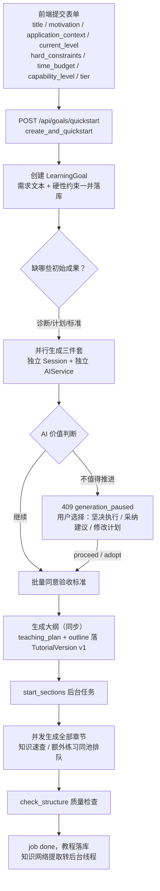
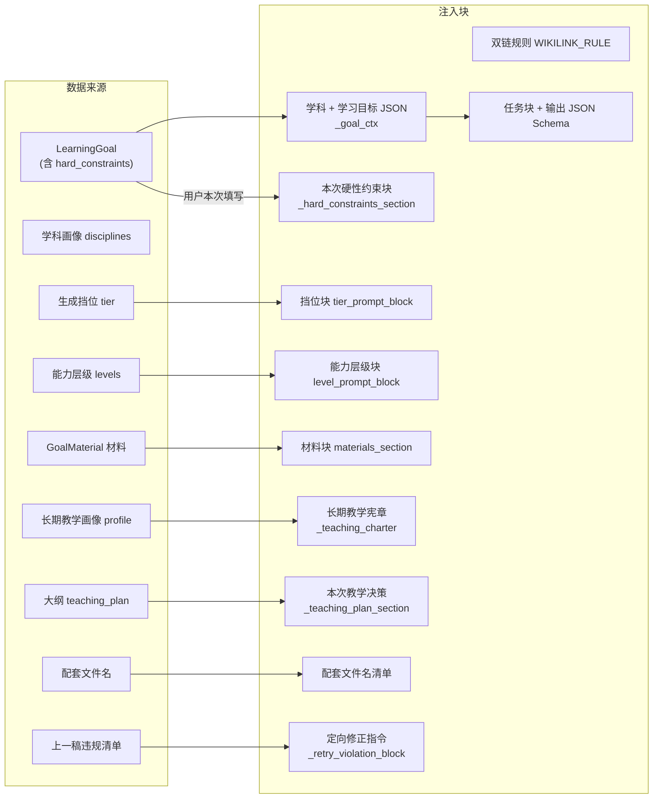
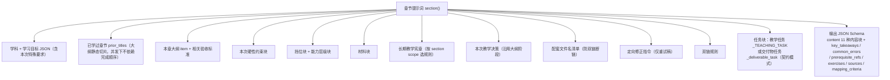
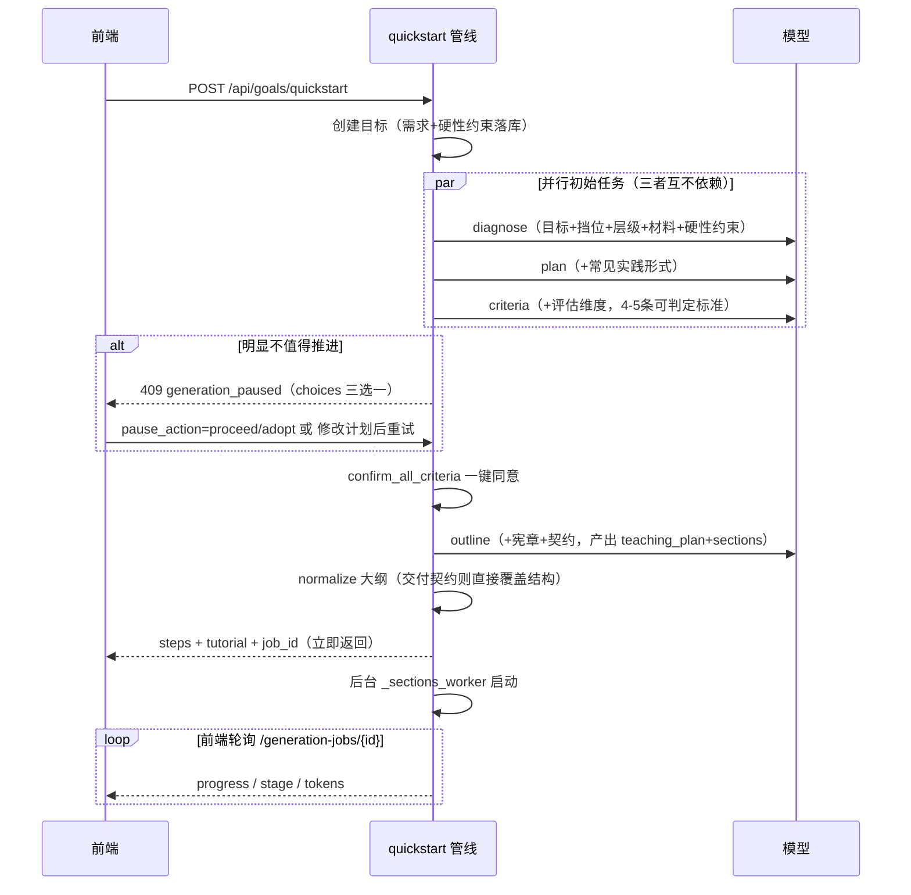
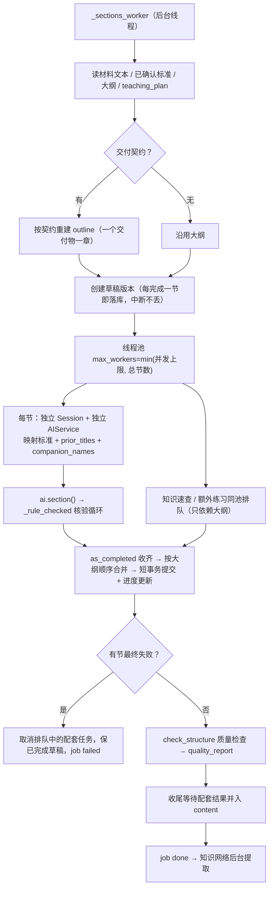
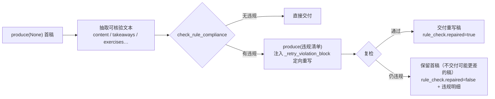

# 教程生成详细流程（提示词注入与作用机制）

> 本文对应代码：`services/api/app/services/pipeline.py`（一键生成管线）、
> `services/api/app/services/tutorials.py`（大纲 / 章节 / 配套文件）、
> `services/api/app/llm/prompts.py`（全部提示词模板）、
> `services/api/app/llm/service.py`（AIService：调用、核验、记账）、
> `services/api/app/learning/teaching_profile.py`（长期教学画像 / 交付契约 / 硬约束核验）。

## 1. 总览：一次点击发生什么

用户在「创建并生成教程」表单提交后，`POST /api/goals/quickstart` 走 `create_and_quickstart → quickstart` 管线，
把「价值诊断 → 决定 → 学习计划 → 验收标准（批量同意）→ 大纲 → 全部章节 + 配套文件」串成一次点击。
除大纲（同步）外，章节与配套文件都是后台任务，接口立即返回 `job_id` 供前端轮询。



幂等设计：管线每一步先查现状，已完成阶段标 `reused` 跳过；已有章节不再重复生成；
在跑的后台任务直接复用其 `job_id`，连点不会重复计费。

---

## 2. 提示词的解剖：每个阶段注入了什么

所有阶段的提示词都由「系统提示 + 用户提示」组成，用户提示是多个**注入块**按固定顺序拼接的。
理解这些块，就能定位「某个要求是在哪进入模型的」。

### 2.1 系统提示（每个阶段相同的前缀）

```
SYSTEM 通用规则（9 条）
  ├─ 只输出严格 JSON、转义换行
  ├─ 不编造来源 / 引用；不确定标「需核验」
  ├─ 先理解后记忆（直觉 → 原理 → 结论）
  ├─ 内容克制、教程独立可用
  ├─ 不安排日程（第 X 天 / 每天 / 每周 禁止出现）
  ├─ 因材施教，不套统一模板
  ├─ Obsidian Markdown 语法正确
  └─ 不添加生效的 #标签与 frontmatter tags
+ tier_system(goal)   挡位独立角色（快速=高效直出 / 标准=课程设计师 / 深度=架构师+审查）
```

### 2.2 用户提示的注入块（按阶段裁剪）



### 2.3 各块详解

| 注入块 | 内容与细节 | 注入阶段 |
|---|---|---|
| **学习目标 JSON**（`_goal_ctx`） | `title / motivation / application_context / current_level / time_budget`；`user_notes` 映射为 `current_task_special_requirements`（本次任务特殊要求） | 全部阶段 |
| **本次硬性约束块**（`_hard_constraints_section`） | 用户创建目标时逐行填写的强制要求，按行编号为清单；声明「任一条不满足即本次交付不合格」，要求输出前逐条自检、冲突时用替代做法并在 note 说明，不得静默忽略。**空则整块不注入，prompt 与原版一致** | 诊断 / 计划 / 标准 / 大纲 / 章节 / 速查 / 练习 / 评估 |
| **挡位块**（`tier_prompt_block`） | 执行要求、输出要求、质量底线、章节数上限（fast=2 / standard=6 / deep=8） | 诊断 / 计划 / 标准 / 大纲 / 章节 / 速查 / 练习 |
| **能力层级块**（`level_prompt_block`） | L1 基础理解 / L2 独立应用 / L3 迁移，决定讲解深度、练习与验收难度 | 诊断 / 计划 / 标准 / 大纲 / 章节 / 速查 / 练习 / 评估 |
| **材料块**（`_materials_section`） | 用户上传材料压缩后的文本（每文件截断、总长上限、标注来源与截断）；附使用规则：优先沿用材料要求，不伪装材料未覆盖内容 | 诊断 / 计划 / 大纲 / 章节 / 速查 / 练习 |
| **长期教学宪章**（`_teaching_charter`） | 用户**长期**画像规则：先按本次目标对条件规则求值（宁多勿丢）；硬约束单列「违反即不合格」，导向类单列并声明冲突时以硬约束为准；附优先级：系统安全 > 硬性约束 > 本次任务特殊要求 > 教学导向 > 材料内容 | 大纲 / 章节 / 速查 / 练习（按阶段 scope 裁剪） |
| **本次教学决策**（`_teaching_plan_section`） | 大纲阶段产出的 `decisions / task_overrides / unresolved_conflicts`，章节生成必须沿用，不重复列规则 | 章节 |
| **配套文件名清单**（`_companion_names_section`） | 提前把「{目标}-知识速查」「{目标}-额外练习」注入，模型只能按这些名字写 `[[双链]]`，杜绝占位断链 | 章节 |
| **定向修正指令**（`_retry_violation_block`） | 上一稿被核验出的违规清单，要求只改违规处、保留其余内容重出完整 JSON | 章节 / 速查 / 练习（重试稿） |
| **双链规则**（`WIKILINK_RULE`） | 只允许 `[[文件名]]` 指向本次配套文件，禁止 `[[...]]`、`[[#标题]]`、`[[别名]]` 等扩展形式；语法演示必须进行内代码 | 大纲 / 章节 |
| **交付契约块**（`_delivery_contract_section`） | 画像出现「只包括 / 只输出 A、B、C」时：交付物清单顺序固定、章节数严格等于清单项数、禁写讲解与答案 | 大纲 / 章节（契约模式） |

> 阶段差异：诊断 / 计划 / 标准三个阶段不走宪章与双链块（它们产出判断而非 Obsidian 正文）；
> 评估阶段（assessment）注入目标 + 评估维度 + 层级 + 硬性约束，产出考核任务。

### 2.4 章节阶段（最重的提示词）拼装全貌



教学任务块内部还规定了 A/B/C 三级知识（核心讲透 / 支撑讲够 / 扩展克制）、
分层讲解（直觉 → 原理 → 结论）、按知识性质选教学方式（概念 / 方法 / 工具 / 事实 / 综合）、
例题克制原则（`exercises` 只放必要练习，巩固题归额外练习文件）。

---

## 3. 管线逐步流程

### 3.1 一键生成的时序



暂停判定细节：只有诊断 `recommendation` 命中 `暂缓|不建议推进|不值得|无法推进` 或用户此前明确「暂停」才 409；
「采纳建议」会把建议文本追加进 `user_notes`，下一轮所有 prompt 的「本次任务特殊要求」即带上它。

### 3.2 大纲阶段：决策沉淀

- 模型返回 `teaching_plan`（rules_applied / decisions / task_overrides / unresolved_conflicts）与 `sections`；
- `_normalize_outline_items` 归一化：补 id、非法 `content_type` 回退 `mixed`、截断到 `MAX_SECTIONS_HINT=8`；
- **交付契约优先**：若画像硬约束含「只包括…」，`_contract_outline` 完全不采信模型大纲——清单即章节，
  一个交付物一章，`content_type` 固定 `application`，并把契约随版本落库（`delivery_contract`）。
  这是「结构性强制」：只靠提示词模型会认为「多写讲解章」不算违规；
- 版本 v1 落库，`tutorial.status` 前进；知识网络提取转后台线程（失败只留痕，不阻断交付）。

### 3.3 章节后台任务（_sections_worker）



细节：
- **并发上限** `AIEDU_LLM_CONCURRENCY`（默认 9）；托管 API 全并行，单卡串行端点须设 1 退化串行防排队超时；
- **单节重试**：超时 / 限流 / 截断自动重试 2 次（延迟 3s、8s），重试原因写进 `job.stage` 与 `retry_count`；
- **SQLite 单写者**：每节只在「读上下文」「写日志」开短事务，等模型期间不持有写锁；
- **配套文件同池**：章节先入队占满线程，配套接档排队，消除「全部章节完成后再串行等 1-2 次往返」的尾巴；
  交付契约模式下配套文件被抑制（`suppress_companions`）；
- **输出归一化** `_normalize_section_raw`：非法块类型回退 `text`、空 body 块丢弃、可选字段缺失置空——
  不会因为没有例题或易错点就判定整节失败。

### 3.4 质量检查与收尾

`check_structure`（确定性检查，不再调用模型）：
1. 大纲与章节齐备（`len(sections) >= len(outline)`）；
2. 每章映射至少一条验收标准；
3. 双向覆盖：每条标准至少被一章覆盖；
4. 章节正文非空；
5. 内容块类型合法、操作步骤含验证方式。

通过则 `status=drafted`，否则 `drafted_with_issues` 并把 issues 存入 `quality_report`。最后：
知识速查 / 额外练习写入 `content`，`job` 标 `done`（stage 注明「知识网络后台更新中」）。

---

## 4. 约束「起作用」的保障环节（不只是写进提示词）

提示词只是第一步；系统用三条机制保证约束真的生效：

### 4.1 确定性核验 + 定向重写（_rule_checked）

章节、速查、练习三个阶段的输出都会过一遍机器可核验的禁止性约束（`COMPLIANCE_GUARDS`）：

| 规则命中（画像禁止项） | 输出命中即违规 |
|---|---|
| 日程 / 时间表 / 第 X 天周 / 每天 | 正文出现「第 X 天」「每天」「每周一投入…」等日历表述 |
| 标签 / tag | 正文出现会生效的 `#标签`（行内代码与代码块内豁免） |



核验结果随章节落库（`rule_check` 字段），可审计「哪一稿修过、为什么」。

### 4.2 交付契约：结构级强制

「只包括 A、B、C」这类穷举式硬约束会被 `delivery_contract` 解析成结构：
模型大纲不采信、清单即章节、`_deliverable` 把任务切成「交付成品」模式（试卷 / 分析 / 拓展，禁写讲解与答案）、
配套文件一并抑制。提示词（`_delivery_contract_section`）+ 结构重建双管齐下。

### 4.3 注入侧的细节保障

- **宁多勿丢**：条件画像规则抽不出触发词时按生效处理；硬约束与阶段无关也强制保留（`select_rules` 不按预算裁剪硬约束）；
- **双链防断链**：配套文件名在章节生成前就确定并注入，`verify_tutorial_md.py` 交付后还会做断链校验；
- **材料预算**：每文件 `PROMPT_PER_FILE_CHARS`、总量 `PROMPT_TOTAL_CHARS` 截断，超限材料明确标注「未注入」而非静默丢弃；
- **优先级声明**：宪章块明确 `系统与安全 > 硬性约束 > 本次任务特殊要求 > 教学导向 > 学习材料`，
  「本次硬性约束块」（用户针对当前目标填写）与「长期画像硬约束」并行生效、互不覆盖。

---

## 5. 阶段 × 注入块矩阵

| 注入块 | 诊断 | 计划 | 标准 | 大纲 | 章节 | 速查 | 练习 | 评估 |
|---|:-:|:-:|:-:|:-:|:-:|:-:|:-:|:-:|
| 学习目标 JSON（含 user_notes） | ✓ | ✓ | ✓ | ✓ | ✓ | ✓ | ✓ | ✓ |
| 本次硬性约束（用户填写） | ✓ | ✓ | ✓ | ✓ | ✓ | ✓ | ✓ | ✓ |
| 生成挡位 | ✓ | ✓ | ✓ | ✓ | ✓ | ✓ | ✓ | — |
| 能力层级 | ✓ | ✓ | ✓ | ✓ | ✓ | ✓ | ✓ | ✓ |
| 上传材料 | ✓ | ✓ | — | ✓ | ✓ | ✓ | ✓ | — |
| 长期教学宪章 | — | — | — | ✓ | ✓ | ✓ | ✓ | — |
| 本次教学决策（teaching_plan） | — | — | — | 产出 | ✓ | — | — | — |
| 交付契约块 | — | — | — | ✓ | ✓ | — | — | — |
| 配套文件名清单 | — | — | — | — | ✓ | — | — | — |
| 定向修正指令（retry） | — | — | — | — | ✓* | ✓* | ✓* | — |
| 双链规则 | — | — | — | ✓ | ✓ | — | — | — |
| 阶段专属内容 | 学科画像 | 常见实践形式 + 不排日程 | 评估维度 + 可判定 pass_rule | 大纲四步内审 | 教学任务 / 交付物任务 | 速查取材范围 | 克制出题 + 参考习题类型 | 独立/变式任务 |

\* 仅在上一稿被核验出违规时出现。

---

## 6. 观测与记账

每次调用写入 `ModelCallLog`（feature / provider / model / latency / tokens），成功调用同时写 `TrainingRecord`
（system + user prompt + 输出，供测试版训练导出）；失败只记调用日志不产生训练样本。
token 优先用 provider usage，缺失时按「CJK 1 字 1 token、其余 4 字符 1 token」估算并标 `estimated`。
前端轮询 `GenerationJob` 获取 progress / stage / retry_count / 累计 tokens，`stage` 文本即当前注入执行进度的可读摘要。

## 7. 常见排查入口

| 现象 | 查哪里 |
|---|---|
| 某约束没体现在教程里 | 该约束是否落库（`GET /api/goals/{id}` 的 `hard_constraints`）；对应阶段 prompt 是否注入（矩阵）；是否触发 `rule_check`（章节详情） |
| 章节数与预期不符 | 是否命中交付契约（`delivery_contract` 随版本落库）；挡位 `max_sections` 上限 |
| 生成中断不丢内容 | 草稿版本每节提交；失败信息在 `job.error_message`（保留根因 2000 字符） |
| 双链断链 | 配套文件名清单块；`scripts/verify_tutorial_md.py` 校验输出 |
